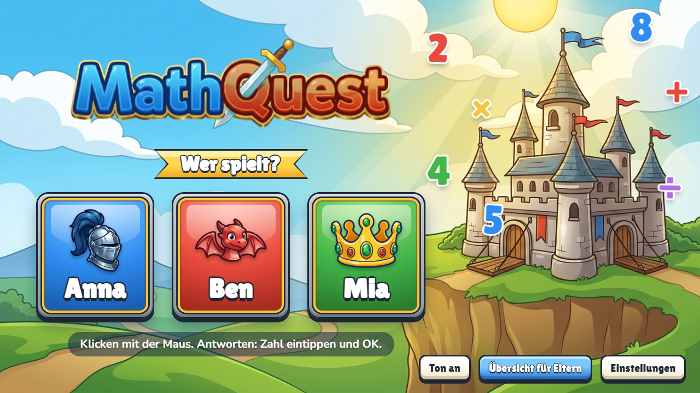
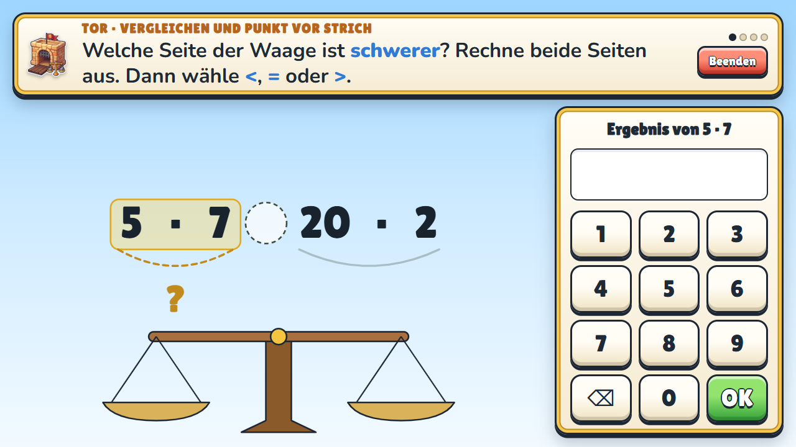

# MathQuest

Mathe-Lernspiel für die **4. Klasse** (Grundschule, LehrplanPLUS Bayern), gemacht für den Fernseher im Wohnzimmer, läuft aber genauso am Laptop. Jedes Kind baut über das Schuljahr seine eigene 3D-Burg: Jedes Mathe-Thema ist ein Teil der Burg, und was sitzt, wird zu Stein und bekommt eine Fahne.

- **Lokal und offline:** kein Konto, keine Cloud, keine Werbung. Alle Daten bleiben auf dem Rechner.
- **Kurz und regelmäßig:** eine Runde dauert ca. 12 Minuten. Ein Karteikasten wiederholt, was noch wackelt.
- **Bedienung nach Wahl:** Maus und Ziffernfeld, oder vom Sofa aus mit einer Wii Remote und Spracheingabe.

Entstanden als Familienprojekt für unsere eigenen Kinder. Es ist ein Hobbyprojekt: kostenlos, ohne Gewähr und ohne Zusage für Support oder Weiterentwicklung (MIT-Lizenz, siehe unten).



## Was man braucht

| | |
|---|---|
| Rechner | Windows 10 oder 11. Ein normaler Laptop reicht (getestet mit Intel Iris Xe und 16 GB RAM). Mac und Linux: siehe [Ohne Windows](#ohne-windows) |
| Programme | [Node.js](https://nodejs.org) 22 oder neuer (das Einrichtungsskript installiert es auf Wunsch), Google Chrome oder Microsoft Edge |
| Optional | Fernseher per HDMI, Wii Remote mit DolphinBar, Spracherkennung, Funkmikrofon: [docs/hardware.md](docs/hardware.md) |

## Installieren

1. Oben auf GitHub **Code → Download ZIP** und entpacken, z. B. nach `Dokumente\MathQuest`. Oder mit Git: `git clone`.
2. Im Ordner **`Einrichten.cmd`** doppelklicken. Es prüft Node.js (installiert es nach Rückfrage mit winget) und legt auf dem Desktop die Verknüpfung **MathQuest** an.
3. **MathQuest** auf dem Desktop starten. Beim ersten Start erscheint die Einrichtung: Profile anlegen (Name, Bild, Burgfarbe) und die Bedienung wählen. Später geht das über **Einstellungen** auf dem Startbildschirm.

Der Starter startet den lokalen Server (`server/server.js`, Port 8642, nur auf diesem Rechner erreichbar) und öffnet das Spiel als eigenes Fenster auf dem größten Bildschirm. Ein Klick auf ein Profil schaltet in den Vollbildmodus. Läuft das Spiel schon, holt der Starter das Fenster nach vorn.

## Bedienung

Unter **Einstellungen → Bedienung**:

| Zeigen und klicken | |
|---|---|
| **Maus oder Touchscreen** (Standard) | Klicken wie gewohnt |
| **Wii Remote** | Zeigen und A drücken. Braucht eine DolphinBar und die [Couch Workstation](https://github.com/Mark296688/CouchWorkstation), siehe [docs/hardware.md](docs/hardware.md) |

| Antworten | |
|---|---|
| **Ziffern tippen** (Standard) | Ziffernfeld auf dem Bildschirm oder Tastatur (Ziffern, Enter). Die Antwort zählt sofort. |
| **Sprechen** | Zahl sagen, am besten als Satz: „Das Ergebnis ist …“. Das Programm [Handy](https://github.com/cjpais/Handy) erkennt die Sprache lokal. Mit der Wii Remote B halten, sonst das Tastenkürzel von Handy (Standard Strg+Leertaste). Das Spiel zeigt, was es verstanden hat; erst mit „Ja“ wird bewertet (mit der Wii Remote auch Taste +, − für „Nein, nochmal“). Klappt die Sprache nicht, gibt es „Ziffern tippen“. |

## Eine Runde (ca. 12 Minuten, am Wochenende ca. 14)

Nach der Baustelle kommt unter der Woche **eine** Station: Steinmetzhütte oder Tor, im Wechsel (die, die länger nicht dran war). Am Wochenende kommen beide.

| Teil | Inhalt |
|---|---|
| Fundament | 6 bis 12 Einmaleins-Aufgaben aus dem Karteikasten, mal und geteilt: Übungskarten, fällige und neue; sichere Familien höchstens 6 je Runde. Sitzt alles, nur 6 Aufgaben. Manchmal in Fachsprache („Dividiere 56 durch 7“). Falsche Aufgaben kommen am Ende noch einmal dran. |
| Baustelle | 5 Bauaufträge mit Zehnerzahlen (Mauer: 6 · 60, Turm: 540 : 60) und 2 Kran-Würfe auf den Zahlenstrahl. Steht eine Familie im Fundament und im Mauerring als Stein, sind bis zu 3 der 5 Aufträge Hunderter-Aufgaben (6 · 700, 60 · 70, 4200 : 700, 4200 : 6, 4200 : 60). |
| Steinmetzhütte | Geometrie: „Welche zwei Teile ergeben dieses Quadrat/Rechteck/Dreieck?“ (später auch drei Teile), dazu Faltschnitte für die Rosettenfenster der Kapelle („Welches gefaltete Blatt ergibt aufgefaltet welches Fenster?“). Nach zwei Fehlversuchen zeigt das Spiel die Lösung. |
| Tor | Vier Aufgaben im Wechsel. **Waage:** zwei Rechnungen vergleichen (9 · 9 ○ 30 · 2, später mit Zehnerzahlen). Erst beide Seiten ausrechnen, dann <, = oder > wählen. **Punkt vor Strich:** zuerst auf das Rechenzeichen zeigen, das man zuerst rechnet, dann die Punktrechnungen, dann das Ergebnis (5 · 6 + 7 · 7, später 540 : 60 − 2 · 2). Teilergebnisse stehen unter einem Bogen. |
| Turnier | 60 Sekunden, nur sichere Aufgaben, Rekord gegen sich selbst. Kommt, sobald 4 Familien sicher sind. |
| Bauabnahme | Die eigene 3D-Burg zeigt, was seit dem letzten Mal neu dazugekommen ist. |
| Album | „Das hast du geschafft“ und die Einmaleins-Tafel. Danach „Noch eine Runde“, „Meine Burg“ oder „Fertig für heute“. |

**Fehler:** Beim ersten Fehler gibt es einen Tipp (beim Einmaleins mit Punktefeld, z. B. 5 · 8 + 2 · 8), dann einen zweiten Versuch. Danach zeigt das Spiel Lösung und Rechenweg.



## Lernmotor

- 36 Einmaleins-Familien (2 · 2 bis 9 · 9). Mal- und Geteiltaufgaben einer Familie gehören zusammen.
- Karteikasten mit Fächern 0–5:
  - unbekannt → im ersten Versuch richtig und in höchstens 7 Sekunden: sicher (Fach 3)
  - langsam richtig: Fach 2
  - falsch: Fach 1 (üben)
- Abstände: Fach 1 sofort, Fach 2 am nächsten Tag, dann 2, 4 und 8 Tage.
- Pro Runde höchstens 4 Übungskarten, dazu fällige und neue Karten. Die ersten Runden prüfen, was schon sitzt.
- Bauaufträge nehmen bevorzugt Familien, die schon fast sitzen. Dann geht es um die Nullen, nicht um das Einmaleins.
- Kran: Nach 3 Volltreffern in Folge wird der nächste Zahlenraum frei (1000 → 10 000 → 100 000 → 1 Million).

Welche Lern- und Spielprinzipien belegt sind (verteiltes Üben, Abrufübung, Tempo, intrinsische Integration) und wo die Grenzen der Studien liegen: [docs/recherche-lernwirksamkeit.md](docs/recherche-lernwirksamkeit.md).

## Die Burg

Jedes Kind baut seine eigene Burg. Jeder Bereich gehört zu einem Mathe-Thema:

- **Fundament:** 36 Steine, einer pro Einmaleins-Familie
- **Mauerring:** 36 Stücke im inneren Ring für die Bauaufträge mit Zehnerzahlen (6 · 70, 420 : 60) und 36 im äußeren Ring für die Hunderter-Aufgaben (6 · 700, 60 · 70, 4200 : 60)
- **Türme:** einer pro Zahlenraum am Kran (bis 1000, 10 000, 100 000, 1 Million)
- **Steinmetzhütte** vor der Burg: vier Werkstücke und zwei Rosettenfenster
- **Tor:** Torflügel und Zugbrücke (Waage), Fallgitter und Torhaus (Punkt vor Strich)
- Marktplatz, Bergfried und Brunnen sind als Bauplan zu sehen und kommen mit späteren Themen.

Jedes Bauteil hat drei Stufen: **Gerüst** nach dem ersten Üben, **Stein** nach „im ersten Versuch richtig“ an zwei verschiedenen Tagen, **Fahne** nach „schnell richtig“ an zwei Tagen. Was steht, bleibt stehen.

## Für Eltern

- **Übersicht für Eltern** (Startbildschirm): je Profil Sitzungen, Spielzeit, sichere und wackelige Aufgaben, Null-Fehler bei Zehnerzahlen, Kran, Turnier-Rekord, Stand der Burg und (bei Spracheingabe) die Erkennungsquote.
- Die Inhalte folgen dem LehrplanPLUS Bayern (Jahrgangsstufe 3/4) und der üblichen Reihenfolge bayerischer Schulbücher der 4. Klasse. Weitere Themen (schriftliche Verfahren, Größen, Sachaufgaben) sind geplant, aber nicht zugesagt.

## Daten

Alles liegt im Ordner `data/` im MathQuest-Ordner und verlässt den Rechner nicht. Der Server ist nur unter 127.0.0.1 erreichbar.

| Datei | Inhalt |
|---|---|
| `data/einstellungen.json` | Profile und Bedienung (im Spiel unter „Einstellungen“) |
| `data/profiles/<id>.json` | Spielstand je Profil |
| `data/logs/<id>.jsonl` | Protokoll jeder Aufgabe mit Antworten, Zeiten und (bei Sprache) dem erkannten Text |
| `data/papierkorb/` | Spielstand und Protokoll gelöschter Profile |

Zum Sichern den Ordner `data/` kopieren. Beim Aktualisieren von MathQuest (neue Version herunterladen) den Ordner `data/` in den neuen Ordner übernehmen.

Zwei Einstellungen gibt es nur in der Datei, Abschnitt `start` (für den Windows-Starter):

```json
"start": {
  "mikrofon": "USBAudio1.0",
  "couchWorkstation": "D:\\Programme\\CouchWorkstation\\CouchWorkstation.exe"
}
```

- `mikrofon`: Teil des Gerätenamens eines Mikrofons, das beim Start Windows-Standard werden soll, wenn es eingesteckt ist (z. B. ein Funkmikrofon). Leer: nichts umstellen.
- `couchWorkstation`: Pfad zur Couch Workstation. Leer: Der Starter sucht den Ordner `CouchWorkstation` neben dem MathQuest-Ordner.

## Ohne Windows

Auf Mac und Linux (oder ohne Starter): im MathQuest-Ordner `npm start` ausführen und im Browser `http://localhost:8642` öffnen. Wii Remote und Couch Workstation gibt es nur für Windows.

## Entwicklung

- `npm test`: Tests der Logik (Aufgaben über viele Seeds, Rechenwege, Zahlerkennung, Karteikasten, Burg, Einstellungen). Ohne npm-Pakete, Node 22.
- `npm start`: nur den Server starten. Zum Testen mit eigenen Daten: `MATHQUEST_PORT=8643 MATHQUEST_DATA=<Ordner> npm start`
- `src/`: Spiel als ES-Module ohne Build. Reine Logik in `src/js/rng.js`, `parse.js`, `einmaleins.js`, `bau.js`, `motor.js`, `burg.js`, `geo.js`, `tor.js`, `einstellungen.js`; Oberfläche in `app.js`, `scenes.js`, `steinmetz.js`, `torszene.js`; 3D-Burg in `burg3d.js`
- Adresse mit `?debug`: Zugriff auf den Ablauf über `window.__mq`; `?idle=3`: Endlos-Animationen halten schon nach 3 s an (sonst 45 s)
- `server/`: lokaler Server für Dateien, Spielstände und Einstellungen
- `tools/start.ps1`: Starter, `tools/einrichten.ps1`: Einrichtung, `tools/MathQuest.ico`: Symbol der Verknüpfung

## Lizenzen

MathQuest steht unter der [MIT-Lizenz](LICENSE). Mitgeliefert sind:

| Teil | Lizenz |
|---|---|
| [Three.js](https://threejs.org) 0.186.1, `src/vendor/three/` | MIT, `src/vendor/three/LICENSE` |
| [Kenney Castle Kit](https://kenney.nl/assets/castle-kit) 2.0, `src/assets/castle/` | CC0, `src/assets/castle/License.txt` |
| Schriften Lilita One und Nunito, `src/assets/fonts/` | SIL Open Font License, Lizenztexte daneben |
| Menügrafiken und Symbol, `src/assets/ui/`, `tools/MathQuest.ico` | mit dem Bildgenerator Google Gemini („Nano Banana“) erzeugt und nachbearbeitet |

Für die optionale Bedienung mit Wii Remote und Sprache: [Couch Workstation](https://github.com/Mark296688/CouchWorkstation) (MIT) und [Handy](https://github.com/cjpais/Handy) (eigenes Projekt, eigene Lizenz). „Wii“ und „Wii Remote“ sind Marken von Nintendo; MathQuest hat mit Nintendo nichts zu tun.
